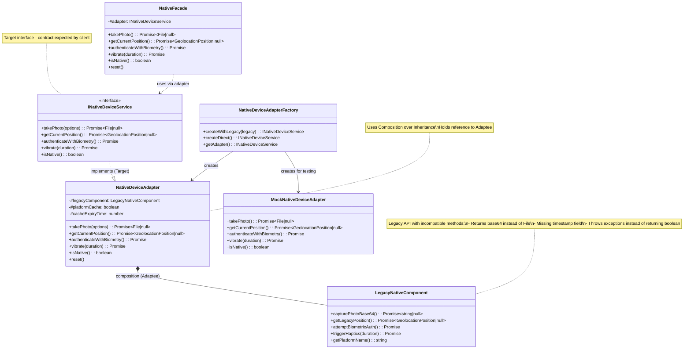
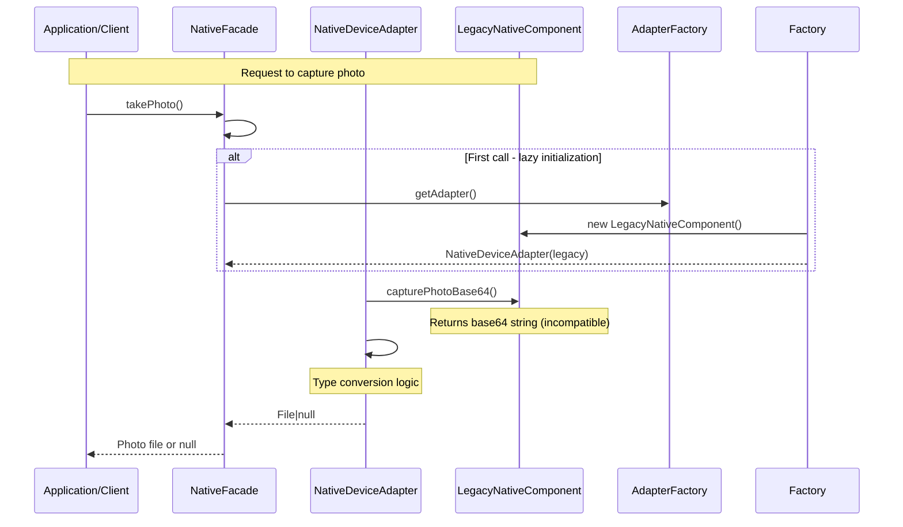

# Adapter Pattern Implementation - UML Diagram

## Overview

This document describes the Object Adapter Pattern implementation for integrating legacy native components with modern system architecture.

## Class Diagram (Mermaid)



## Sequence Diagram (Mermaid)



## Component Relationships

### 1. Target Interface (INativeDeviceService)
- **Role**: Defines the contract expected by client code
- **Responsibility**: Specifies methods and return types that must be supported
- **Implementation**: Implemented by Adapter class

### 2. Adaptee (LegacyNativeComponent)
- **Role**: Existing legacy component with incompatible interface
- **Characteristics**: 
  - Uses older API patterns
  - Returns different data types (base64 vs File)
  - Missing required fields (timestamp)
  - Exception-based error handling instead of boolean returns

### 3. Adapter (NativeDeviceAdapter)
- **Role**: Bridges Target and Adaptee using composition
- **Key Features**:
  - Holds reference to LegacyNativeComponent via constructor injection
  - Translates incompatible return types
  - Adds missing functionality
  - Handles parameter discrepancies
  - Provides state isolation through caching

### 4. Factory (NativeDeviceAdapterFactory)
- **Role**: Creates adapter instances with dependency injection
- **Benefits**:
  - Decouples client from concrete adapter implementation
  - Enables testing with mock adapters
  - Supports runtime adapter selection

## Pattern Justification

### Why Object Adapter Pattern?

1. **Composition over Inheritance**: More flexible and testable than Class Adapter pattern
2. **Single Responsibility**: Each class has one clear purpose
3. **Open/Closed Principle**: Easy to add new adapters without modifying existing code
4. **Dependency Injection**: Facilitates testing and configuration flexibility

### Trade-offs

| Aspect | Benefit | Cost |
|--------|---------|------|
| Flexibility | Can swap implementations easily | Slightly more complex initialization |
| Testability | Mocking is straightforward | Requires factory pattern setup |
| Maintainability | Clear separation of concerns | More files to manage |
| Performance | Minimal overhead (just method forwarding) | Caching adds memory usage |

## Usage Example

```javascript
import { NativeDeviceAdapterFactory } from './shared/services';

// Option 1: Automatic adapter selection
const service = NativeDeviceAdapterFactory.getAdapter();
await service.takePhoto();

// Option 2: Explicit legacy component adaptation
import LegacyNativeComponent from './LegacyNativeComponent';
const legacy = new LegacyNativeComponent();
const adapter = NativeDeviceAdapterFactory.createWithLegacy(legacy);

// Option 3: For testing - use mock implementation
const testAdapter = NativeDeviceAdapterFactory.createDirect();
```

## Files Created/Modified

1. `INativeDeviceService.js` - Target interface definition
2. `LegacyNativeComponent.js` - Adaptee with legacy methods
3. `NativeDeviceAdapter.js` - Object adapter implementation
4. `index.js` - Updated exports and factory pattern
5. `nativeFacade.js` - Facade using adapter pattern
6. `adapter-pattern-uml.md` - This documentation
